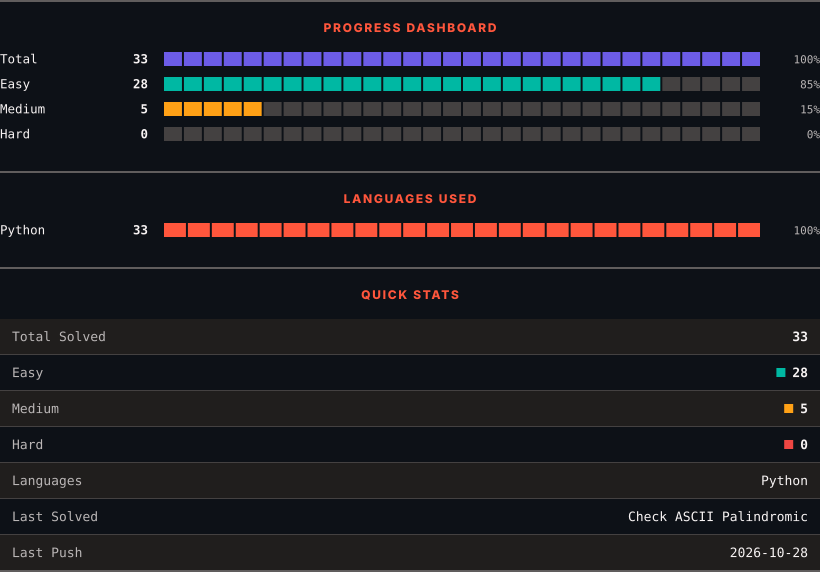
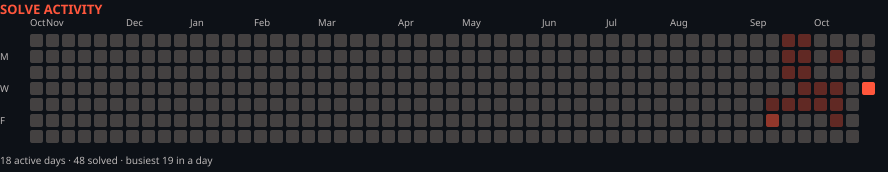

<h1>LeetCode Solutions</h1>

<em>Automatically synced with every accepted submission</em>

   

<picture>
  <source media="(prefers-color-scheme: dark)" srcset=".leetsync/stats-dark.svg">
  <source media="(prefers-color-scheme: light)" srcset=".leetsync/stats-light.svg">
  
</picture>

<picture>
  <source media="(prefers-color-scheme: dark)" srcset=".leetsync/calendar-dark.svg">
  <source media="(prefers-color-scheme: light)" srcset=".leetsync/calendar-light.svg">
  
</picture>

---

### ALL SOLUTIONS

**Latest 10**

| # | Problem | Difficulty | Language | Date |
|:---:|:--------|:----------:|:--------:|:----:|
| 3959 | [Check Good Integer](problems/3959-Check-Good-Integer) | 🟩 Easy | `Python` | 2026-10-28 |
| 3863 | [Minimum Operations to Sort a String](problems/3863-Minimum-Operations-to-Sort-a-String) | 🟧 Medium | `Python` | 2026-10-28 |
| 3340 | [Check Balanced String](problems/3340-Check-Balanced-String) | 🟩 Easy | `Python` | 2026-10-28 |
| 3274 | [Check if Two Chessboard Squares Have the Same Color](problems/3274-Check-if-Two-Chessboard-Squares-Have-the-Same-Color) | 🟩 Easy | `Python` | 2026-10-28 |
| 2396 | [Strictly Palindromic Number](problems/2396-Strictly-Palindromic-Number) | 🟧 Medium | `Python` | 2026-10-28 |
| 2299 | [Strong Password Checker II](problems/2299-Strong-Password-Checker-II) | 🟩 Easy | `Python` | 2026-10-28 |
| 2089 | [Find Target Indices After Sorting Array](problems/2089-Find-Target-Indices-After-Sorting-Array) | 🟩 Easy | `Python` | 2026-10-28 |
| 1572 | [Matrix Diagonal Sum](problems/1572-Matrix-Diagonal-Sum) | 🟩 Easy | `Python` | 2026-10-28 |
| 1287 | [Element Appearing More Than 25% In Sorted Array](problems/1287-Element-Appearing-More-Than-25-In-Sorted-Array) | 🟩 Easy | `Python` | 2026-10-28 |
| 374 | [Guess Number Higher or Lower](problems/0374-Guess-Number-Higher-or-Lower) | 🟩 Easy | `Python` | 2026-10-28 |

<strong>🟩 Easy</strong> — 36 solved

| # | Problem | Difficulty | Language | Date |
|:---:|:--------|:----------:|:--------:|:----:|
| 20 | [Valid Parentheses](problems/0020-Valid-Parentheses) | 🟩 Easy | `Python` | 2026-10-01 |
| 69 | [Sqrt(x)](problems/0069-Sqrtx) | 🟩 Easy | `Python` | 2026-09-22 |
| 182 | [Duplicate Emails](problems/0182-Duplicate-Emails) | 🟩 Easy | `MySQL` | 2026-10-28 |
| 231 | [Power of Two](problems/0231-Power-of-Two) | 🟩 Easy | `Python` | 2026-09-21 |
| 263 | [Ugly Number](problems/0263-Ugly-Number) | 🟩 Easy | `Python` | 2026-09-21 |
| 342 | [Power of Four](problems/0342-Power-of-Four) | 🟩 Easy | `Python` | 2026-09-22 |
| 349 | [Intersection of Two Arrays](problems/0349-Intersection-of-Two-Arrays) | 🟩 Easy | `Python` | 2026-10-28 |
| 374 | [Guess Number Higher or Lower](problems/0374-Guess-Number-Higher-or-Lower) | 🟩 Easy | `Python` | 2026-10-28 |
| 383 | [Ransom Note](problems/0383-Ransom-Note) | 🟩 Easy | `Python` | 2026-09-18 |
| 389 | [Find the Difference](problems/0389-Find-the-Difference) | 🟩 Easy | `Python` | 2026-10-14 |
| 507 | [Perfect Number](problems/0507-Perfect-Number) | 🟩 Easy | `Python` | 2026-09-17 |
| 509 | [Fibonacci Number](problems/0509-Fibonacci-Number) | 🟩 Easy | `Python` | 2026-10-16 |
| 594 | [Longest Harmonious Subsequence](problems/0594-Longest-Harmonious-Subsequence) | 🟩 Easy | `Python` | 2026-09-28 |
| 674 | [Longest Continuous Increasing Subsequence](problems/0674-Longest-Continuous-Increasing-Subsequence) | 🟩 Easy | `Python` | 2026-09-28 |
| 771 | [Jewels and Stones](problems/0771-Jewels-and-Stones) | 🟩 Easy | `Python` | 2026-09-17 |
| 1021 | [Remove Outermost Parentheses](problems/1021-Remove-Outermost-Parentheses) | 🟩 Easy | `Python` | 2026-10-08 |
| 1108 | [Defanging an IP Address](problems/1108-Defanging-an-IP-Address) | 🟩 Easy | `Python` | 2026-09-18 |
| 1281 | [Subtract the Product and Sum of Digits of an Integer](problems/1281-Subtract-the-Product-and-Sum-of-Digits-of-an-Integer) | 🟩 Easy | `Python` | 2026-09-18 |
| 1287 | [Element Appearing More Than 25% In Sorted Array](problems/1287-Element-Appearing-More-Than-25-In-Sorted-Array) | 🟩 Easy | `Python` | 2026-10-28 |
| 1346 | [Check If N and Its Double Exist](problems/1346-Check-If-N-and-Its-Double-Exist) | 🟩 Easy | `Python` | 2026-09-28 |
| 1351 | [Count Negative Numbers in a Sorted Matrix](problems/1351-Count-Negative-Numbers-in-a-Sorted-Matrix) | 🟩 Easy | `Python` | 2026-09-27 |
| 1512 | [Number of Good Pairs](problems/1512-Number-of-Good-Pairs) | 🟩 Easy | `Python` | 2026-09-18 |
| 1572 | [Matrix Diagonal Sum](problems/1572-Matrix-Diagonal-Sum) | 🟩 Easy | `Python` | 2026-10-28 |
| 1614 | [Maximum Nesting Depth of the Parentheses](problems/1614-Maximum-Nesting-Depth-of-the-Parentheses) | 🟩 Easy | `Python` | 2026-09-28 |
| 1678 | [Goal Parser Interpretation](problems/1678-Goal-Parser-Interpretation) | 🟩 Easy | `Python` | 2026-09-18 |
| 1688 | [Count of Matches in Tournament](problems/1688-Count-of-Matches-in-Tournament) | 🟩 Easy | `Python` | 2026-09-30 |
| 2089 | [Find Target Indices After Sorting Array](problems/2089-Find-Target-Indices-After-Sorting-Array) | 🟩 Easy | `Python` | 2026-10-28 |
| 2299 | [Strong Password Checker II](problems/2299-Strong-Password-Checker-II) | 🟩 Easy | `Python` | 2026-10-28 |
| 2441 | [Largest Positive Integer That Exists With Its Negative](problems/2441-Largest-Positive-Integer-That-Exists-With-Its-Negative) | 🟩 Easy | `Python` | 2026-10-12 |
| 2913 | [Subarrays Distinct Element Sum of Squares I](problems/2913-Subarrays-Distinct-Element-Sum-of-Squares-I) | 🟩 Easy | `Python` | 2026-10-15 |
| 3274 | [Check if Two Chessboard Squares Have the Same Color](problems/3274-Check-if-Two-Chessboard-Squares-Have-the-Same-Color) | 🟩 Easy | `Python` | 2026-10-28 |
| 3340 | [Check Balanced String](problems/3340-Check-Balanced-String) | 🟩 Easy | `Python` | 2026-10-28 |
| 3498 | [Reverse Degree of a String](problems/3498-Reverse-Degree-of-a-String) | 🟩 Easy | `Python` | 2026-09-20 |
| 3550 | [Smallest Index With Digit Sum Equal to Index](problems/3550-Smallest-Index-With-Digit-Sum-Equal-to-Index) | 🟩 Easy | `Python` | 2026-09-24 |
| 3959 | [Check Good Integer](problems/3959-Check-Good-Integer) | 🟩 Easy | `Python` | 2026-10-28 |
| 4030 | [Check ASCII Palindromic](problems/4030-Check-ASCII-Palindromic) | 🟩 Easy | `Python` | 2026-09-29 |

<strong>🟧 Medium</strong> — 6 solved

| # | Problem | Difficulty | Language | Date |
|:---:|:--------|:----------:|:--------:|:----:|
| 11 | [Container With Most Water](problems/0011-Container-With-Most-Water) | 🟧 Medium | `Python` | 2026-10-07 |
| 15 | [3Sum](problems/0015-3Sum) | 🟧 Medium | `Python` | 2026-10-07 |
| 74 | [Search a 2D Matrix](problems/0074-Search-a-2D-Matrix) | 🟧 Medium | `Python` | 2026-10-28 |
| 2396 | [Strictly Palindromic Number](problems/2396-Strictly-Palindromic-Number) | 🟧 Medium | `Python` | 2026-10-28 |
| 2486 | [Append Characters to String to Make Subsequence](problems/2486-Append-Characters-to-String-to-Make-Subsequence) | 🟧 Medium | `Python` | 2026-10-14 |
| 3863 | [Minimum Operations to Sort a String](problems/3863-Minimum-Operations-to-Sort-a-String) | 🟧 Medium | `Python` | 2026-10-28 |

---

Auto-synced by <strong>LeetSync</strong> · Built by <a href="https://deveshsamant.in/">Devesh Samant</a>

