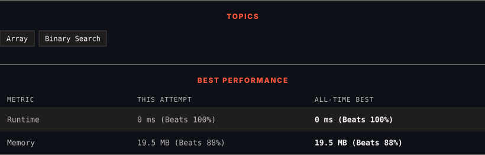

<div align="center">

# 81. Search in Rotated Sorted Array II

      

[](https://leetcode.com/problems/search-in-rotated-sorted-array-ii/)

</div>

---

<div align="center">

<picture>
  <source media="(prefers-color-scheme: dark)" srcset="panel-dark.svg">
  <source media="(prefers-color-scheme: light)" srcset="panel-light.svg">
  
</picture>

</div>

> **New personal best** — Runtime improved on this submission.

### HOW IT WENT

| | |
|:--|:--|
| **Attempts** | first try |
| **Time to solve** | 335 h 54 min |
| **Verdicts** | ✅ Accepted |

---

### NOTES

_No notes yet._

---

### SOLUTIONS (1)

| # | File | Language | Date |
|:-:|------|:--------:|:----:|
| 1 | [sol1.py](./sol1.py) | `Python` | 2026-11-11 ← **latest** |

---

### PROBLEM DESCRIPTION

There is an integer array `nums` sorted in non-decreasing order (not necessarily with **distinct** values).

Before being passed to your function, `nums` is **rotated** at an unknown pivot index `k` (`0 <= k < nums.length`) such that the resulting array is `[nums[k], nums[k+1], ..., nums[n-1], nums[0], nums[1], ..., nums[k-1]]` (**0-indexed**). For example, `[0,1,2,4,4,4,5,6,6,7]` might be rotated at pivot index `5` and become `[4,5,6,6,7,0,1,2,4,4]`.

Given the array `nums` **after** the rotation and an integer `target`, return `true`* if *`target`* is in *`nums`*, or *`false`* if it is not in *`nums`*.*

You must decrease the overall operation steps as much as possible.

 

**Example 1:**

```
**Input:** nums = [2,5,6,0,0,1,2], target = 0
**Output:** true

```

**Example 2:**

```
**Input:** nums = [2,5,6,0,0,1,2], target = 3
**Output:** false

```

 

**Constraints:**

	- `1 <= nums.length <= 5000`

	- `-10^4 <= nums[i] <= 10^4`

	- `nums` is guaranteed to be rotated at some pivot.

	- `-10^4 <= target <= 10^4`

 

**Follow up:** This problem is similar to [Search in Rotated Sorted Array](/problems/search-in-rotated-sorted-array/description/), but `nums` may contain **duplicates**. Would this affect the runtime complexity? How and why?

---

<div align="center">

<sub>Auto-synced by <strong>LeetSync</strong> · Built by <a href="https://deveshsamant.in/">Devesh Samant</a></sub>

</div>
