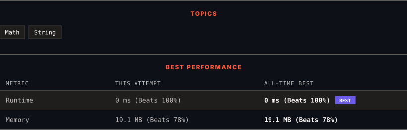

<div align="center">

# 171. Excel Sheet Column Number

      

[](https://leetcode.com/problems/excel-sheet-column-number/)

</div>

---

<div align="center">

<picture>
  <source media="(prefers-color-scheme: dark)" srcset="panel-dark.svg">
  <source media="(prefers-color-scheme: light)" srcset="panel-light.svg">
  
</picture>

</div>

> **New personal best** — Runtime improved on this submission.

### HOW IT WENT

| | |
|:--|:--|
| **Attempts** | first try |
| **Time to solve** | 3 min |
| **Verdicts** | ✅ Accepted |

---

### NOTES

_No notes yet._

---

### SOLUTIONS (1)

| # | File | Language | Date |
|:-:|------|:--------:|:----:|
| 1 | [sol1.py](./sol1.py) | `Python` | 2026-10-29 ← **latest** |

---

### PROBLEM DESCRIPTION

Given a string `columnTitle` that represents the column title as appears in an Excel sheet, return *its corresponding column number*.

For example:

```

A -> 1
B -> 2
C -> 3
...
Z -> 26
AA -> 27
AB -> 28 
...

```

 

**Example 1:**

```

**Input:** columnTitle = "A"
**Output:** 1

```

**Example 2:**

```

**Input:** columnTitle = "AB"
**Output:** 28

```

**Example 3:**

```

**Input:** columnTitle = "ZY"
**Output:** 701

```

 

**Constraints:**

	- `1 <= columnTitle.length <= 7`

	- `columnTitle` consists only of uppercase English letters.

	- `columnTitle` is in the range `["A", "FXSHRXW"]`.

---

<div align="center">

<sub>Auto-synced by <strong>LeetSync</strong> · Built by <a href="https://deveshsamant.in/">Devesh Samant</a></sub>

</div>
