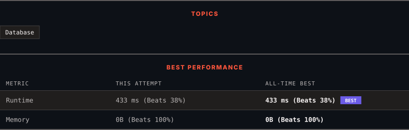

<div align="center">

# 181. Employees Earning More Than Their Managers

      

[](https://leetcode.com/problems/employees-earning-more-than-their-managers/)

</div>

---

<div align="center">

<picture>
  <source media="(prefers-color-scheme: dark)" srcset="panel-dark.svg">
  <source media="(prefers-color-scheme: light)" srcset="panel-light.svg">
  
</picture>

</div>

> **New personal best** — Runtime improved on this submission.

### HOW IT WENT

| | |
|:--|:--|
| **Attempts** | first try |
| **Time to solve** | 11 min |
| **Verdicts** | ✅ Accepted |

---

### NOTES

_No notes yet._

---

### SOLUTIONS (1)

| # | File | Language | Date |
|:-:|------|:--------:|:----:|
| 1 | [sol1.sql](./sol1.sql) | `MySQL` | 2026-10-28 ← **latest** |

---

### PROBLEM DESCRIPTION

Table: `Employee`

```

+-------------+---------+
| Column Name | Type    |
+-------------+---------+
| id          | int     |
| name        | varchar |
| salary      | int     |
| managerId   | int     |
+-------------+---------+
id is the primary key (column with unique values) for this table.
Each row of this table indicates the ID of an employee, their name, salary, and the ID of their manager.

```

 

Write a solution to find the employees who earn more than their managers.

Return the result table in **any order**.

The result format is in the following example.

 

**Example 1:**

```

**Input:** 
Employee table:
+----+-------+--------+-----------+
| id | name  | salary | managerId |
+----+-------+--------+-----------+
| 1  | Joe   | 70000  | 3         |
| 2  | Henry | 80000  | 4         |
| 3  | Sam   | 60000  | Null      |
| 4  | Max   | 90000  | Null      |
+----+-------+--------+-----------+
**Output:** 
+----------+
| Employee |
+----------+
| Joe      |
+----------+
**Explanation:** Joe is the only employee who earns more than his manager.

```

---

<div align="center">

<sub>Auto-synced by <strong>LeetSync</strong> · Built by <a href="https://deveshsamant.in/">Devesh Samant</a></sub>

</div>
