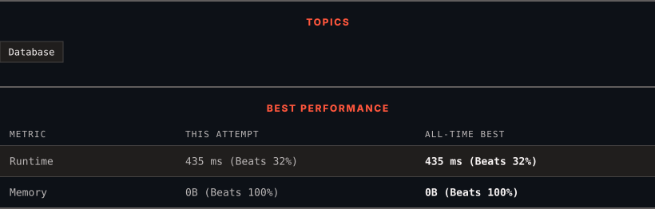

<div align="center">

# 182. Duplicate Emails

      

[](https://leetcode.com/problems/duplicate-emails/)

</div>

---

<div align="center">

<picture>
  <source media="(prefers-color-scheme: dark)" srcset="panel-dark.svg">
  <source media="(prefers-color-scheme: light)" srcset="panel-light.svg">
  
</picture>

</div>

### HOW IT WENT

| | |
|:--|:--|
| **Attempts** | first try |
| **Time to solve** | 4 min |
| **Verdicts** | ✅ Accepted |

---

### NOTES

_No notes yet._

---

### SOLUTIONS (2)

| # | File | Language | Date |
|:-:|------|:--------:|:----:|
| 1 | [sol1.sql](./sol1.sql) | `MySQL` | 2026-10-28 |
| 2 | [sol2.sql](./sol2.sql) | `MySQL` | 2026-10-28 ← **latest** |

---

### PROBLEM DESCRIPTION

Table: `Person`

```

+-------------+---------+
| Column Name | Type    |
+-------------+---------+
| id          | int     |
| email       | varchar |
+-------------+---------+
id is the primary key (column with unique values) for this table.
Each row of this table contains an email. The emails will not contain uppercase letters.

```

 

Write a solution to report all the duplicate emails. Note that it's guaranteed that the email field is not NULL.

Return the result table in **any order**.

The result format is in the following example.

 

**Example 1:**

```

**Input:** 
Person table:
+----+---------+
| id | email   |
+----+---------+
| 1  | a@b.com |
| 2  | c@d.com |
| 3  | a@b.com |
+----+---------+
**Output:** 
+---------+
| Email   |
+---------+
| a@b.com |
+---------+
**Explanation:** a@b.com is repeated two times.

```

---

<div align="center">

<sub>Auto-synced by <strong>LeetSync</strong> · Built by <a href="https://deveshsamant.in/">Devesh Samant</a></sub>

</div>
