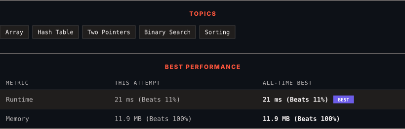

<div align="center">

# 349. Intersection of Two Arrays

      

[](https://leetcode.com/problems/intersection-of-two-arrays/)

</div>

---

<div align="center">

<picture>
  <source media="(prefers-color-scheme: dark)" srcset="panel-dark.svg">
  <source media="(prefers-color-scheme: light)" srcset="panel-light.svg">
  
</picture>

</div>

### HOW IT WENT

| | |
|:--|:--|
| **Attempts** | 2 before accepted |
| **Time to solve** | 117 h 55 min |
| **Verdicts** | ✅ Accepted → ✅ Accepted |

---

### NOTES

_No notes yet._

---

### SOLUTIONS (2)

| # | File | Language | Date |
|:-:|------|:--------:|:----:|
| 1 | [sol1.py](./sol1.py) | `Python` | 2026-10-28 |
| 2 | [sol2.py](./sol2.py) | `Python` | 2026-10-28 ← **latest** |

---

### PROBLEM DESCRIPTION

Given two integer arrays `nums1` and `nums2`, return *an array of their intersection*. Each element in the result must be **unique** and you may return the result in **any order**.

 

**Example 1:**

```

**Input:** nums1 = [1,2,2,1], nums2 = [2,2]
**Output:** [2]

```

**Example 2:**

```

**Input:** nums1 = [4,9,5], nums2 = [9,4,9,8,4]
**Output:** [9,4]
**Explanation:** [4,9] is also accepted.

```

 

**Constraints:**

	- `1 <= nums1.length, nums2.length <= 1000`

	- `0 <= nums1[i], nums2[i] <= 1000`

---

<div align="center">

<sub>Auto-synced by <strong>LeetSync</strong> · Built by <a href="https://deveshsamant.in/">Devesh Samant</a></sub>

</div>
