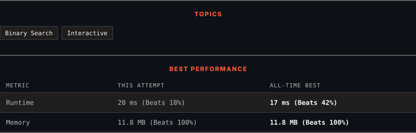

<div align="center">

# 374. Guess Number Higher or Lower

      

[](https://leetcode.com/problems/guess-number-higher-or-lower/)

</div>

---

<div align="center">

<picture>
  <source media="(prefers-color-scheme: dark)" srcset="panel-dark.svg">
  <source media="(prefers-color-scheme: light)" srcset="panel-light.svg">
  
</picture>

</div>

### HOW IT WENT

| | |
|:--|:--|
| **Attempts** | first try |
| **Time to solve** | 8 min |
| **Verdicts** | ✅ Accepted |

---

### NOTES

_No notes yet._

---

### SOLUTIONS (2)

| # | File | Language | Date |
|:-:|------|:--------:|:----:|
| 1 | [sol1.py](./sol1.py) | `Python` | 2026-10-28 |
| 2 | [sol2.py](./sol2.py) | `Python` | 2026-10-28 ← **latest** |

---

### PROBLEM DESCRIPTION

We are playing the Guess Game. The game is as follows:

I pick a number from `1` to `n`. You have to guess which number I picked (the number I picked stays the same throughout the game).

Every time you guess wrong, I will tell you whether the number I picked is higher or lower than your guess.

You call a pre-defined API `int guess(int num)`, which returns three possible results:

	- `-1`: Your guess is higher than the number I picked (i.e. `num > pick`).

	- `1`: Your guess is lower than the number I picked (i.e. `num < pick`).

	- `0`: your guess is equal to the number I picked (i.e. `num == pick`).

Return *the number that I picked*.

 

**Example 1:**

```

**Input:** n = 10, pick = 6
**Output:** 6

```

**Example 2:**

```

**Input:** n = 1, pick = 1
**Output:** 1

```

**Example 3:**

```

**Input:** n = 2, pick = 1
**Output:** 1

```

 

**Constraints:**

	- `1 <= n <= 2^31 - 1`

	- `1 <= pick <= n`

---

<div align="center">

<sub>Auto-synced by <strong>LeetSync</strong> · Built by <a href="https://deveshsamant.in/">Devesh Samant</a></sub>

</div>
