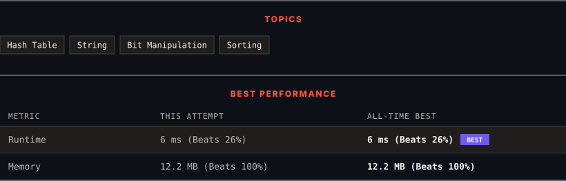

<div align="center">

# 389. Find the Difference

      

[](https://leetcode.com/problems/find-the-difference/)

</div>

---

<div align="center">

<picture>
  <source media="(prefers-color-scheme: dark)" srcset="panel-dark.svg">
  <source media="(prefers-color-scheme: light)" srcset="panel-light.svg">
  
</picture>

</div>

> **New personal best** — Runtime improved on this submission.

### HOW IT WENT

| | |
|:--|:--|
| **Attempts** | 3 before accepted |
| **Time to solve** | 8 min |
| **Verdicts** | ❌ Wrong Answer → ❌ Wrong Answer → ✅ Accepted |

---

### NOTES

_No notes yet._

---

### SOLUTIONS (1)

| # | File | Language | Date |
|:-:|------|:--------:|:----:|
| 1 | [sol1.py](./sol1.py) | `Python` | 2026-10-14 ← **latest** |

---

### PROBLEM DESCRIPTION

You are given two strings `s` and `t`.

String `t` is generated by random shuffling string `s` and then add one more letter at a random position.

Return the letter that was added to `t`.

 

**Example 1:**

```

**Input:** s = "abcd", t = "abcde"
**Output:** "e"
**Explanation:** 'e' is the letter that was added.

```

**Example 2:**

```

**Input:** s = "", t = "y"
**Output:** "y"

```

 

**Constraints:**

	- `0 <= s.length <= 1000`

	- `t.length == s.length + 1`

	- `s` and `t` consist of lowercase English letters.

---

<div align="center">

<sub>Auto-synced by <strong>LeetSync</strong> · Built by <a href="https://deveshsamant.in/">Devesh Samant</a></sub>

</div>
