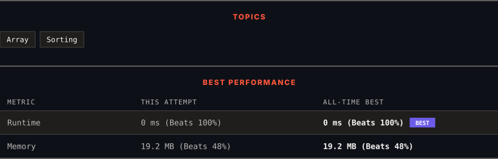

<div align="center">

# 747. Largest Number At Least Twice of Others

      

[](https://leetcode.com/problems/largest-number-at-least-twice-of-others/)

</div>

---

<div align="center">

<picture>
  <source media="(prefers-color-scheme: dark)" srcset="panel-dark.svg">
  <source media="(prefers-color-scheme: light)" srcset="panel-light.svg">
  
</picture>

</div>

> **New personal best** — Runtime improved on this submission.

### HOW IT WENT

| | |
|:--|:--|
| **Attempts** | 2 before accepted |
| **Time to solve** | 102 h 37 min |
| **Verdicts** | ✅ Accepted → ✅ Accepted |

---

### NOTES

_No notes yet._

---

### SOLUTIONS (1)

| # | File | Language | Date |
|:-:|------|:--------:|:----:|
| 1 | [sol1.py](./sol1.py) | `Python` | 2026-10-30 ← **latest** |

---

### PROBLEM DESCRIPTION

You are given an integer array `nums` where the largest integer is **unique**.

Determine whether the largest element in the array is **at least twice** as much as every other number in the array. If it is, return *the **index** of the largest element, or return *`-1`* otherwise*.

 

**Example 1:**

```

**Input:** nums = [3,6,1,0]
**Output:** 1
**Explanation:** 6 is the largest integer.
For every other number in the array x, 6 is at least twice as big as x.
The index of value 6 is 1, so we return 1.

```

**Example 2:**

```

**Input:** nums = [1,2,3,4]
**Output:** -1
**Explanation:** 4 is less than twice the value of 3, so we return -1.

```

 

**Constraints:**

	- `2 <= nums.length <= 50`

	- `0 <= nums[i] <= 100`

	- The largest element in `nums` is unique.

---

<div align="center">

<sub>Auto-synced by <strong>LeetSync</strong> · Built by <a href="https://deveshsamant.in/">Devesh Samant</a></sub>

</div>
