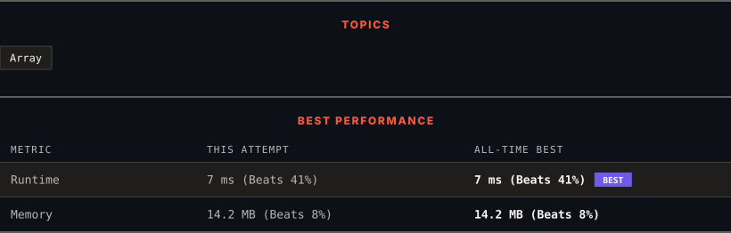

<div align="center">

# 1287. Element Appearing More Than 25% In Sorted Array

      

[](https://leetcode.com/problems/element-appearing-more-than-25-in-sorted-array/)

</div>

---

<div align="center">

<picture>
  <source media="(prefers-color-scheme: dark)" srcset="panel-dark.svg">
  <source media="(prefers-color-scheme: light)" srcset="panel-light.svg">
  
</picture>

</div>

> **New personal best** — Runtime improved on this submission.

### HOW IT WENT

| | |
|:--|:--|
| **Attempts** | 2 before accepted |
| **Time to solve** | 10 min |
| **Verdicts** | ❌ Wrong Answer → ✅ Accepted |

---

### NOTES

_No notes yet._

---

### SOLUTIONS (1)

| # | File | Language | Date |
|:-:|------|:--------:|:----:|
| 1 | [sol1.py](./sol1.py) | `Python` | 2026-10-28 ← **latest** |

---

### PROBLEM DESCRIPTION

Given an integer array **sorted** in non-decreasing order, there is exactly one integer in the array that occurs more than 25% of the time, return that integer.

 

**Example 1:**

```

**Input:** arr = [1,2,2,6,6,6,6,7,10]
**Output:** 6

```

**Example 2:**

```

**Input:** arr = [1,1]
**Output:** 1

```

 

**Constraints:**

	- `1 <= arr.length <= 10^4`

	- `0 <= arr[i] <= 10^5`

---

<div align="center">

<sub>Auto-synced by <strong>LeetSync</strong> · Built by <a href="https://deveshsamant.in/">Devesh Samant</a></sub>

</div>
