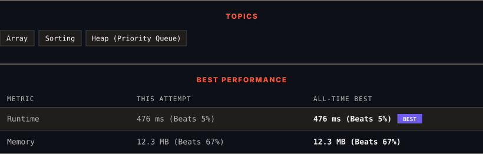

<div align="center">

# 1464. Maximum Product of Two Elements in an Array

      

[](https://leetcode.com/problems/maximum-product-of-two-elements-in-an-array/)

</div>

---

<div align="center">

<picture>
  <source media="(prefers-color-scheme: dark)" srcset="panel-dark.svg">
  <source media="(prefers-color-scheme: light)" srcset="panel-light.svg">
  
</picture>

</div>

> **New personal best** — Runtime improved on this submission.

### HOW IT WENT

| | |
|:--|:--|
| **Attempts** | first try |
| **Time to solve** | 17 h |
| **Verdicts** | ✅ Accepted |

---

### NOTES

_No notes yet._

---

### SOLUTIONS (1)

| # | File | Language | Date |
|:-:|------|:--------:|:----:|
| 1 | [sol1.py](./sol1.py) | `Python` | 2026-10-28 ← **latest** |

---

### PROBLEM DESCRIPTION

You are given an array of integers `nums`.

Choose two **different** indices `i` and `j` of that array.

Return the **maximum** value of `(nums[i] - 1) * (nums[j] - 1)`.

 

**Example 1:**

```

**Input:** nums = [3,4,5,2]
**Output:** 12 
**Explanation:** If you choose the indices i=1 and j=2 (indexed from 0), you will get the maximum value, that is, (nums[1]-1)*(nums[2]-1) = (4-1)*(5-1) = 3*4 = 12. 

```

**Example 2:**

```

**Input:** nums = [1,5,4,5]
**Output:** 16
**Explanation:** Choosing the indices i=1 and j=3 (indexed from 0), you will get the maximum value of (5-1)*(5-1) = 16.

```

**Example 3:**

```

**Input:** nums = [3,7]
**Output:** 12

```

 

**Constraints:**

	- `2 <= nums.length <= 500`

	- `1 <= nums[i] <= 10^3`

---

<div align="center">

<sub>Auto-synced by <strong>LeetSync</strong> · Built by <a href="https://deveshsamant.in/">Devesh Samant</a></sub>

</div>
