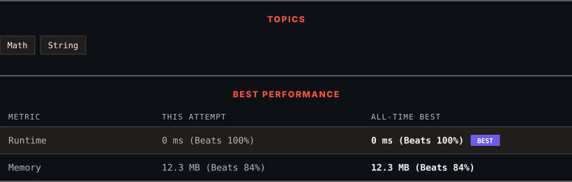

<div align="center">

# 1812. Determine Color of a Chessboard Square

      

[](https://leetcode.com/problems/determine-color-of-a-chessboard-square/)

</div>

---

<div align="center">

<picture>
  <source media="(prefers-color-scheme: dark)" srcset="panel-dark.svg">
  <source media="(prefers-color-scheme: light)" srcset="panel-light.svg">
  
</picture>

</div>

> **New personal best** — Runtime improved on this submission.

### HOW IT WENT

| | |
|:--|:--|
| **Attempts** | 2 before accepted |
| **Time to solve** | 14 min |
| **Verdicts** | ❌ Wrong Answer → ✅ Accepted |

---

### NOTES

_No notes yet._

---

### SOLUTIONS (1)

| # | File | Language | Date |
|:-:|------|:--------:|:----:|
| 1 | [sol1.py](./sol1.py) | `Python` | 2026-10-28 ← **latest** |

---

### PROBLEM DESCRIPTION

You are given `coordinates`, a string that represents the coordinates of a square of the chessboard. Below is a chessboard for your reference.


Return `true`* if the square is white, and *`false`* if the square is black*.

The coordinate will always represent a valid chessboard square. The coordinate will always have the letter first, and the number second.

 

**Example 1:**

```

**Input:** coordinates = "a1"
**Output:** false
**Explanation:** From the chessboard above, the square with coordinates "a1" is black, so return false.

```

**Example 2:**

```

**Input:** coordinates = "h3"
**Output:** true
**Explanation:** From the chessboard above, the square with coordinates "h3" is white, so return true.

```

**Example 3:**

```

**Input:** coordinates = "c7"
**Output:** false

```

 

**Constraints:**

	- `coordinates.length == 2`

	- `'a' <= coordinates[0] <= 'h'`

	- `'1' <= coordinates[1] <= '8'`

---

<div align="center">

<sub>Auto-synced by <strong>LeetSync</strong> · Built by <a href="https://deveshsamant.in/">Devesh Samant</a></sub>

</div>
