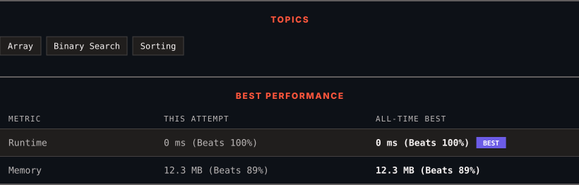

<div align="center">

# 2089. Find Target Indices After Sorting Array

      

[](https://leetcode.com/problems/find-target-indices-after-sorting-array/)

</div>

---

<div align="center">

<picture>
  <source media="(prefers-color-scheme: dark)" srcset="panel-dark.svg">
  <source media="(prefers-color-scheme: light)" srcset="panel-light.svg">
  
</picture>

</div>

### HOW IT WENT

| | |
|:--|:--|
| **Attempts** | 3 before accepted |
| **Time to solve** | 7 min |
| **Verdicts** | ✅ Accepted → ✅ Accepted → ✅ Accepted |

---

### NOTES

_No notes yet._

---

### SOLUTIONS (2)

| # | File | Language | Date |
|:-:|------|:--------:|:----:|
| 1 | [sol1.py](./sol1.py) | `Python` | 2026-10-28 |
| 2 | [sol2.py](./sol2.py) | `Python` | 2026-10-28 ← **latest** |

---

### PROBLEM DESCRIPTION

You are given a **0-indexed** integer array `nums` and a target element `target`.

A **target index** is an index `i` such that `nums[i] == target`.

Return *a list of the target indices of* `nums` after* sorting *`nums`* in **non-decreasing** order*. If there are no target indices, return *an **empty** list*. The returned list must be sorted in **increasing** order.

 

**Example 1:**

```

**Input:** nums = [1,2,5,2,3], target = 2
**Output:** [1,2]
**Explanation:** After sorting, nums is [1,**2**,**2**,3,5].
The indices where nums[i] == 2 are 1 and 2.

```

**Example 2:**

```

**Input:** nums = [1,2,5,2,3], target = 3
**Output:** [3]
**Explanation:** After sorting, nums is [1,2,2,**3**,5].
The index where nums[i] == 3 is 3.

```

**Example 3:**

```

**Input:** nums = [1,2,5,2,3], target = 5
**Output:** [4]
**Explanation:** After sorting, nums is [1,2,2,3,**5**].
The index where nums[i] == 5 is 4.

```

 

**Constraints:**

	- `1 <= nums.length <= 100`

	- `1 <= nums[i], target <= 100`

---

<div align="center">

<sub>Auto-synced by <strong>LeetSync</strong> · Built by <a href="https://deveshsamant.in/">Devesh Samant</a></sub>

</div>
