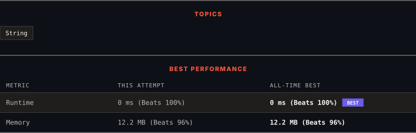

<div align="center">

# 2299. Strong Password Checker II

      

[](https://leetcode.com/problems/strong-password-checker-ii/)

</div>

---

<div align="center">

<picture>
  <source media="(prefers-color-scheme: dark)" srcset="panel-dark.svg">
  <source media="(prefers-color-scheme: light)" srcset="panel-light.svg">
  
</picture>

</div>

### HOW IT WENT

| | |
|:--|:--|
| **Attempts** | 2 before accepted |
| **Time to solve** | 40 min |
| **Verdicts** | ❌ Wrong Answer → ✅ Accepted |

---

### NOTES

_No notes yet._

---

### SOLUTIONS (2)

| # | File | Language | Date |
|:-:|------|:--------:|:----:|
| 1 | [sol1.py](./sol1.py) | `Python` | 2026-10-28 |
| 2 | [sol2.py](./sol2.py) | `Python` | 2026-10-28 ← **latest** |

---

### PROBLEM DESCRIPTION

A password is said to be **strong** if it satisfies all the following criteria:

	- It has at least `8` characters.

	- It contains at least **one lowercase** letter.

	- It contains at least **one uppercase** letter.

	- It contains at least **one digit**.

	- It contains at least **one special character**. The special characters are the characters in the following string: `"!@#$%^&*()-+"`.

	- It does **not** contain `2` of the same character in adjacent positions (i.e., `"aab"` violates this condition, but `"aba"` does not).

Given a string `password`, return `true`* if it is a **strong** password*. Otherwise, return `false`.

 

**Example 1:**

```

**Input:** password = "IloveLe3tcode!"
**Output:** true
**Explanation:** The password meets all the requirements. Therefore, we return true.

```

**Example 2:**

```

**Input:** password = "Me+You--IsMyDream"
**Output:** false
**Explanation:** The password does not contain a digit and also contains 2 of the same character in adjacent positions. Therefore, we return false.

```

**Example 3:**

```

**Input:** password = "1aB!"
**Output:** false
**Explanation:** The password does not meet the length requirement. Therefore, we return false.
```

 

**Constraints:**

	- `1 <= password.length <= 100`

	- `password` consists of letters, digits, and special characters: `"!@#$%^&*()-+"`.

---

<div align="center">

<sub>Auto-synced by <strong>LeetSync</strong> · Built by <a href="https://deveshsamant.in/">Devesh Samant</a></sub>

</div>
