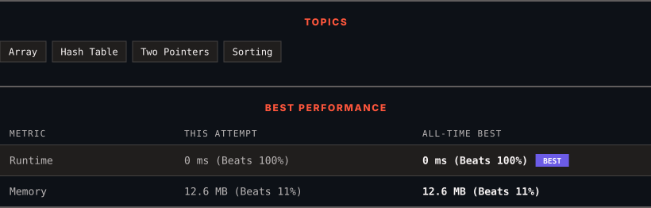

<div align="center">

# 2441. Largest Positive Integer That Exists With Its Negative

      

[](https://leetcode.com/problems/largest-positive-integer-that-exists-with-its-negative/)

</div>

---

<div align="center">

<picture>
  <source media="(prefers-color-scheme: dark)" srcset="panel-dark.svg">
  <source media="(prefers-color-scheme: light)" srcset="panel-light.svg">
  
</picture>

</div>

> **New personal best** — Runtime improved on this submission.

### HOW IT WENT

| | |
|:--|:--|
| **Attempts** | first try |
| **Time to solve** | 53 min |
| **Verdicts** | ✅ Accepted |

---

### NOTES

_No notes yet._

---

### SOLUTIONS (1)

| # | File | Language | Date |
|:-:|------|:--------:|:----:|
| 1 | [sol1.py](./sol1.py) | `Python` | 2026-10-12 ← **latest** |

---

### PROBLEM DESCRIPTION

Given an integer array `nums` that **does not contain** any zeros, find **the largest positive** integer `k` such that `-k` also exists in the array.

Return *the positive integer *`k`. If there is no such integer, return `-1`.

 

**Example 1:**

```

**Input:** nums = [-1,2,-3,3]
**Output:** 3
**Explanation:** 3 is the only valid k we can find in the array.

```

**Example 2:**

```

**Input:** nums = [-1,10,6,7,-7,1]
**Output:** 7
**Explanation:** Both 1 and 7 have their corresponding negative values in the array. 7 has a larger value.

```

**Example 3:**

```

**Input:** nums = [-10,8,6,7,-2,-3]
**Output:** -1
**Explanation:** There is no a single valid k, we return -1.

```

 

**Constraints:**

	- `1 <= nums.length <= 1000`

	- `-1000 <= nums[i] <= 1000`

	- `nums[i] != 0`

---

<div align="center">

<sub>Auto-synced by <strong>LeetSync</strong> · Built by <a href="https://deveshsamant.in/">Devesh Samant</a></sub>

</div>
