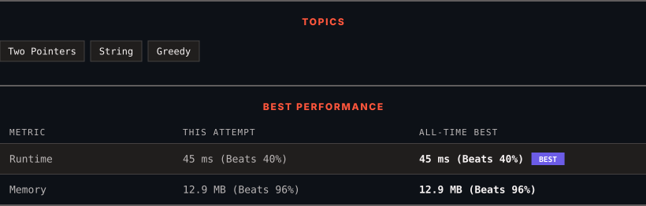

<div align="center">

# 2486. Append Characters to String to Make Subsequence

      

[](https://leetcode.com/problems/append-characters-to-string-to-make-subsequence/)

</div>

---

<div align="center">

<picture>
  <source media="(prefers-color-scheme: dark)" srcset="panel-dark.svg">
  <source media="(prefers-color-scheme: light)" srcset="panel-light.svg">
  
</picture>

</div>

### HOW IT WENT

| | |
|:--|:--|
| **Attempts** | 2 before accepted |
| **Time to solve** | 9 min |
| **Verdicts** | ✅ Accepted → ✅ Accepted |

---

### NOTES

_No notes yet._

---

### SOLUTIONS (2)

| # | File | Language | Date |
|:-:|------|:--------:|:----:|
| 1 | [sol1.py](./sol1.py) | `Python` | 2026-10-14 |
| 2 | [sol2.py](./sol2.py) | `Python` | 2026-10-14 ← **latest** |

---

### PROBLEM DESCRIPTION

You are given two strings `s` and `t` consisting of only lowercase English letters.

Return *the minimum number of characters that need to be appended to the end of *`s`* so that *`t`* becomes a **subsequence** of *`s`.

A **subsequence** is a string that can be derived from another string by deleting some or no characters without changing the order of the remaining characters.

 

**Example 1:**

```

**Input:** s = "coaching", t = "coding"
**Output:** 4
**Explanation:** Append the characters "ding" to the end of s so that s = "coachingding".
Now, t is a subsequence of s ("**co**aching**ding**").
It can be shown that appending any 3 characters to the end of s will never make t a subsequence.

```

**Example 2:**

```

**Input:** s = "abcde", t = "a"
**Output:** 0
**Explanation:** t is already a subsequence of s ("**a**bcde").

```

**Example 3:**

```

**Input:** s = "z", t = "abcde"
**Output:** 5
**Explanation:** Append the characters "abcde" to the end of s so that s = "zabcde".
Now, t is a subsequence of s ("z**abcde**").
It can be shown that appending any 4 characters to the end of s will never make t a subsequence.

```

 

**Constraints:**

	- `1 <= s.length, t.length <= 10^5`

	- `s` and `t` consist only of lowercase English letters.

---

<div align="center">

<sub>Auto-synced by <strong>LeetSync</strong> · Built by <a href="https://deveshsamant.in/">Devesh Samant</a></sub>

</div>
