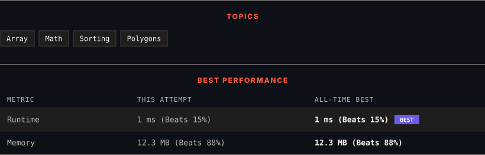

<div align="center">

# 3024. Type of Triangle

      

[](https://leetcode.com/problems/type-of-triangle/)

</div>

---

<div align="center">

<picture>
  <source media="(prefers-color-scheme: dark)" srcset="panel-dark.svg">
  <source media="(prefers-color-scheme: light)" srcset="panel-light.svg">
  
</picture>

</div>

> **New personal best** — Runtime improved on this submission.

### HOW IT WENT

| | |
|:--|:--|
| **Attempts** | 4 before accepted |
| **Time to solve** | 10 min |
| **Verdicts** | ❌ Wrong Answer → ❌ Wrong Answer → ❌ Wrong Answer → ✅ Accepted |

---

### NOTES

_No notes yet._

---

### SOLUTIONS (2)

| # | File | Language | Date |
|:-:|------|:--------:|:----:|
| 1 | [sol1.py](./sol1.py) | `Python` | 2026-10-28 |
| 2 | [sol2.py](./sol2.py) | `Python` | 2026-10-28 ← **latest** |

---

### PROBLEM DESCRIPTION

You are given a **0-indexed** integer array `nums` of size `3` which can form the sides of a triangle.

	- A triangle is called **equilateral** if it has all sides of equal length.

	- A triangle is called **isosceles** if it has exactly two sides of equal length.

	- A triangle is called **scalene** if all its sides are of different lengths.

Return *a string representing* *the type of triangle that can be formed **or *`"none"`* if it **cannot** form a triangle.*

 

**Example 1:**

```

**Input:** nums = [3,3,3]
**Output:** "equilateral"
**Explanation:** Since all the sides are of equal length, therefore, it will form an equilateral triangle.

```

**Example 2:**

```

**Input:** nums = [3,4,5]
**Output:** "scalene"
**Explanation:** 
nums[0] + nums[1] = 3 + 4 = 7, which is greater than nums[2] = 5.
nums[0] + nums[2] = 3 + 5 = 8, which is greater than nums[1] = 4.
nums[1] + nums[2] = 4 + 5 = 9, which is greater than nums[0] = 3. 
Since the sum of the two sides is greater than the third side for all three cases, therefore, it can form a triangle.
As all the sides are of different lengths, it will form a scalene triangle.

```

 

**Constraints:**

	- `nums.length == 3`

	- `1 <= nums[i] <= 100`

---

<div align="center">

<sub>Auto-synced by <strong>LeetSync</strong> · Built by <a href="https://deveshsamant.in/">Devesh Samant</a></sub>

</div>
