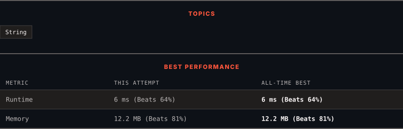

# 3340. Check Balanced String

      

---

<picture>
  <source media="(prefers-color-scheme: dark)" srcset="panel-dark.svg">
  <source media="(prefers-color-scheme: light)" srcset="panel-light.svg">
  
</picture>

### HOW IT WENT

| | |
|:--|:--|
| **Attempts** | first try |
| **Time to solve** | 3 min |
| **Verdicts** | ✅ Accepted |

---

### NOTES

_No notes yet._

---

### SOLUTIONS (2)

| # | File | Language | Date |
|:-:|------|:--------:|:----:|
| 1 | [sol1.py](./sol1.py) | `Python` | 2026-10-28 |
| 2 | [sol2.py](./sol2.py) | `Python` | 2026-10-28 ← **latest** |

---

### PROBLEM DESCRIPTION

You are given a string `num` consisting of only digits. A string of digits is called **balanced **if the sum of the digits at even indices is equal to the sum of digits at odd indices.

Return `true` if `num` is **balanced**, otherwise return `false`.

 

**Example 1:**

**Input:** num = "1234"

**Output:** false

**Explanation:**

	- The sum of digits at even indices is `1 + 3 == 4`, and the sum of digits at odd indices is `2 + 4 == 6`.

	- Since 4 is not equal to 6, `num` is not balanced.

**Example 2:**

**Input:** num = "24123"

**Output:** true

**Explanation:**

	- The sum of digits at even indices is `2 + 1 + 3 == 6`, and the sum of digits at odd indices is `4 + 2 == 6`.

	- Since both are equal the `num` is balanced.

 

**Constraints:**

	- `2 <= num.length <= 100`

	- `num` consists of digits only

---

Auto-synced by <strong>LeetSync</strong> · Built by <a href="https://deveshsamant.in/">Devesh Samant</a>

