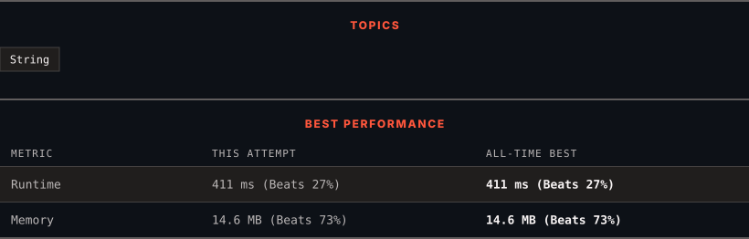

# 3863. Minimum Operations to Sort a String

      

---

<picture>
  <source media="(prefers-color-scheme: dark)" srcset="panel-dark.svg">
  <source media="(prefers-color-scheme: light)" srcset="panel-light.svg">
  
</picture>

### HOW IT WENT

| | |
|:--|:--|
| **Attempts** | 19 before accepted |
| **Time to solve** | 1 h 53 min |
| **Verdicts** | ❌ Wrong Answer → ❌ Wrong Answer → 💥 Runtime Error → ❌ Wrong Answer → 💥 Runtime Error → ❌ Wrong Answer → ❌ Wrong Answer → ❌ Wrong Answer → ❌ Wrong Answer → ❌ Wrong Answer → ❌ Wrong Answer → ✅ Accepted |

---

### NOTES

_No notes yet._

---

### SOLUTIONS (2)

| # | File | Language | Date |
|:-:|------|:--------:|:----:|
| 1 | [sol1.py](./sol1.py) | `Python` | 2026-10-28 |
| 2 | [sol2.py](./sol2.py) | `Python` | 2026-10-28 ← **latest** |

---

### PROBLEM DESCRIPTION

You are given a string `s` consisting of lowercase English letters.

In one operation, you can select any **substring** of `s` that is **not** the entire string and **sort** it in **non-descending alphabetical** order.

Return the **minimum** number of operations required to make `s` sorted in **non-descending** order. If it is not possible, return -1.

 

**Example 1:**

**Input:** s = "dog"

**Output:** 1

**Explanation:**​​​​​​​

	- Sort substring `"og"` to `"go"`.

	- Now, `s = "dgo"`, which is sorted in ascending order. Thus, the answer is 1.

**Example 2:**

**Input:** s = "card"

**Output:** 2

**Explanation:**

	- Sort substring `"car"` to `"acr"`, so `s = "acrd"`.

	- Sort substring `"rd"` to `"dr"`, making `s = "acdr"`, which is sorted in ascending order. Thus, the answer is 2.

**Example 3:**

**Input:** s = "gf"

**Output:** -1

**Explanation:**

	- It is impossible to sort `s` under the given constraints. Thus, the answer is -1.

 

**Constraints:**

	- `1 <= s.length <= 10^5`

	- `s` consists of only lowercase English letters.

---

Auto-synced by <strong>LeetSync</strong> · Built by <a href="https://deveshsamant.in/">Devesh Samant</a>

