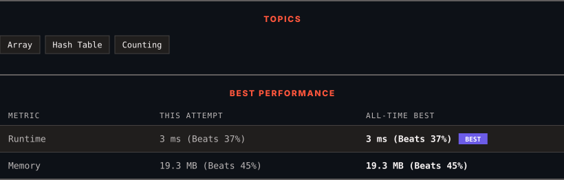

# 3866. First Unique Even Element

      

---

<picture>
  <source media="(prefers-color-scheme: dark)" srcset="panel-dark.svg">
  <source media="(prefers-color-scheme: light)" srcset="panel-light.svg">
  
</picture>

> **New personal best** — Runtime improved on this submission.

### HOW IT WENT

| | |
|:--|:--|
| **Attempts** | first try |
| **Time to solve** | 14 min |
| **Verdicts** | ✅ Accepted |

---

### NOTES

_No notes yet._

---

### SOLUTIONS (1)

| # | File | Language | Date |
|:-:|------|:--------:|:----:|
| 1 | [sol1.py](./sol1.py) | `Python` | 2026-11-19 ← **latest** |

---

### PROBLEM DESCRIPTION

You are given an integer array `nums`.

Return an integer denoting the first **even** integer (earliest by array index) that appears **exactly** once in `nums`. If no such integer exists, return -1.

An integer `x` is considered **even** if it is divisible by 2.

 

**Example 1:**

**Input:** nums = [3,4,2,5,4,6]

**Output:** 2

**Explanation:**

Both 2 and 6 are even and they appear exactly once. Since 2 occurs first in the array, the answer is 2.

**Example 2:**

**Input:** nums = [4,4]

**Output:** -1

**Explanation:**

No even integer appears exactly once, so return -1.

 

**Constraints:**

	- `1 <= nums.length <= 100`

	- `1 <= nums[i] <= 100`

---

Auto-synced by <strong>LeetSync</strong> · Built by <a href="https://deveshsamant.in/">Devesh Samant</a>

