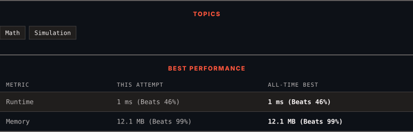

# 3959. Check Good Integer

      

---

<picture>
  <source media="(prefers-color-scheme: dark)" srcset="panel-dark.svg">
  <source media="(prefers-color-scheme: light)" srcset="panel-light.svg">
  
</picture>

### HOW IT WENT

| | |
|:--|:--|
| **Attempts** | 2 before accepted |
| **Time to solve** | 141 h 19 min |
| **Verdicts** | ✅ Accepted → ✅ Accepted |

---

### NOTES

_No notes yet._

---

### SOLUTIONS (4)

| # | File | Language | Date |
|:-:|------|:--------:|:----:|
| 1 | [sol1.py](./sol1.py) | `Python` | 2026-10-28 |
| 2 | [sol2.py](./sol2.py) | `Python` | 2026-10-28 |
| 3 | [sol3.py](./sol3.py) | `Python` | 2026-10-28 |
| 4 | [sol4.py](./sol4.py) | `Python` | 2026-10-28 ← **latest** |

---

### PROBLEM DESCRIPTION

You are given a positive integer `n`.

Let `digitSum` be the sum of the digits of `n`, and let `squareSum` be the sum of the squares of the digits of `n`.

An integer is called **good** if `squareSum - digitSum >= 50`.

Return `true` if `n` is good. Otherwise, return `false`.

 

**Example 1:**

**Input:** n = 1000

**Output:** false

**Explanation:**

	- The digits of 1000 are 1, 0, 0, and 0.

	- The `digitSum` is `1 + 0 + 0 + 0 = 1`.

	- The `squareSum` is `1^2 + 0^2 + 0^2 + 0^2 = 1`.

	- The `squareSum - digitSum` is `1 - 1 = 0`. As 0 is not greater than or equal to 50, the output is `false`.

**Example 2:**

**Input:** n = 19

**Output:** true

**Explanation:**

	- The digits of 19 are 1 and 9.

	- The `digitSum` is `1 + 9 = 10`.

	- The `squareSum` is `1^2 + 9^2 = 1 + 81 = 82`.

	- The `squareSum - digitSum` is `82 - 10 = 72`. As 72 is greater than or equal to 50, the output is `true`.

 

**Constraints:**

	- `1 <= n <= 10^9`

---

Auto-synced by <strong>LeetSync</strong> · Built by <a href="https://deveshsamant.in/">Devesh Samant</a>

