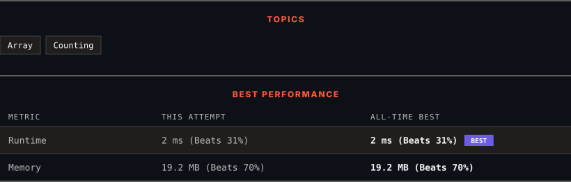

# 3978. Unique Middle Element

      

---

<picture>
  <source media="(prefers-color-scheme: dark)" srcset="panel-dark.svg">
  <source media="(prefers-color-scheme: light)" srcset="panel-light.svg">
  
</picture>

> **New personal best** — Runtime improved on this submission.

### HOW IT WENT

| | |
|:--|:--|
| **Attempts** | first try |
| **Time to solve** | 10 min |
| **Verdicts** | ✅ Accepted |

---

### NOTES

_No notes yet._

---

### SOLUTIONS (1)

| # | File | Language | Date |
|:-:|------|:--------:|:----:|
| 1 | [sol1.py](./sol1.py) | `Python` | 2026-11-19 ← **latest** |

---

### PROBLEM DESCRIPTION

You are given an integer array `nums` of odd length `n`.

Return `true` if the middle element of `nums` appears **exactly** once in the array. Otherwise return `false`.

 

**Example 1:**

**Input:** nums = [1,2,3]

**Output:** true

**Explanation:**

The middle element of `nums` is 2, which appears exactly once.

Thus, the answer is `true`.

**Example 2:**

**Input:** nums = [1,2,2]

**Output:** false

**Explanation:**

The middle element of `nums` is 2, which appears twice.

Thus, the answer is `false`.

 

**Constraints:**

	- `1 <= n == nums.length <= 100`

	- `n` is odd.

	- `1 <= nums[i] <= 100`

---

Auto-synced by <strong>LeetSync</strong> · Built by <a href="https://deveshsamant.in/">Devesh Samant</a>

